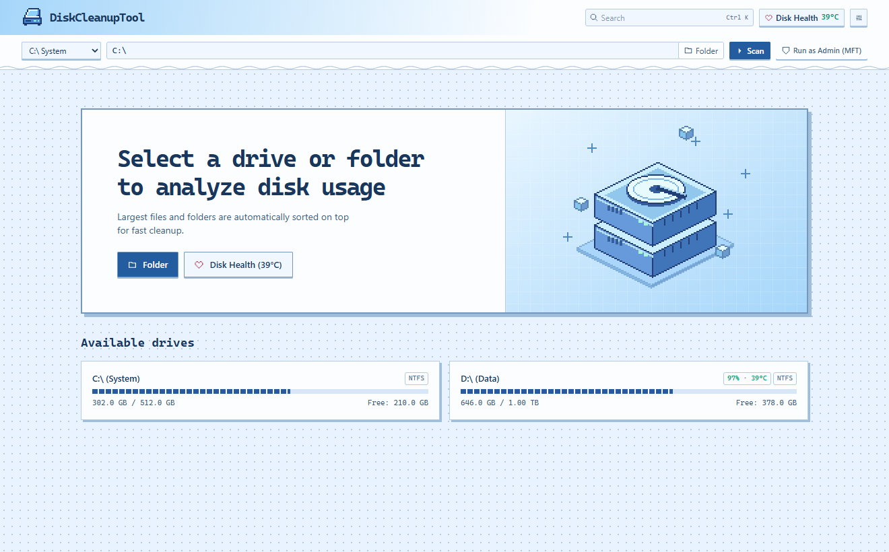
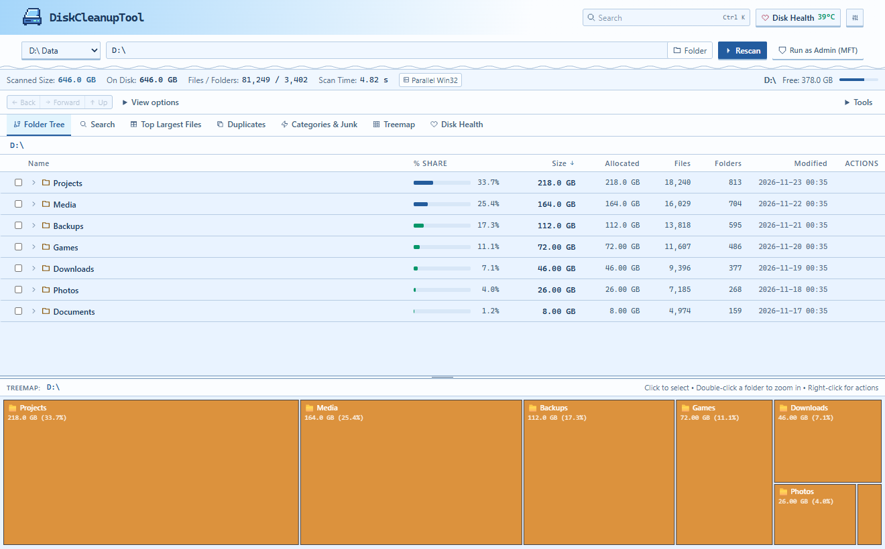
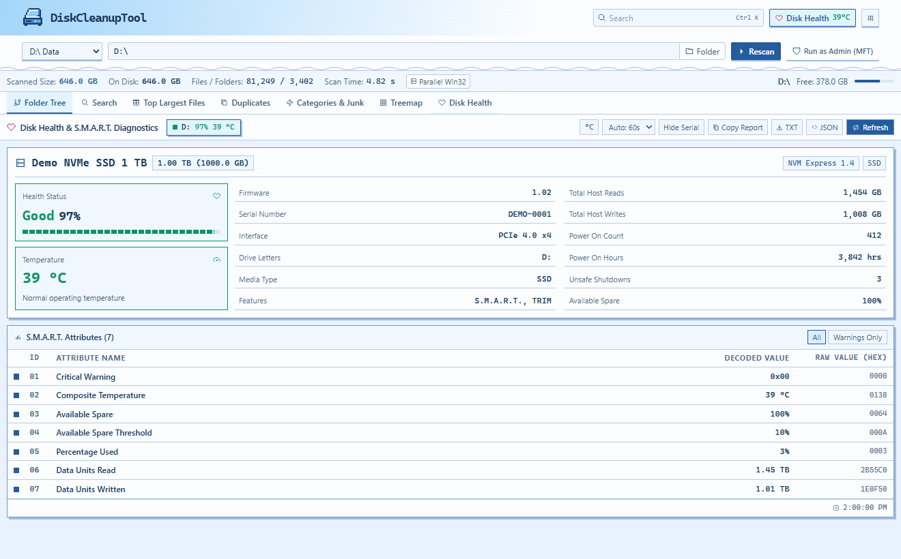

# 

**A Windows utility for finding what takes up disk space, reviewing cleanup candidates, and checking physical drive health.** Built with Rust, Tauri 2, and React, with a pixel-style interface, light and dark themes, and eight UI languages.

[Download for Windows](#download-for-windows) · [Quick start](#quick-start) · [Disk health](#disk-health) · [Build from source](#build-from-source)



*Screenshots show the v0.3.0 interface with sample drive, folder, and S.M.A.R.T. data.*

## Download for Windows

Download the installer or portable ZIP from the [latest GitHub release](https://github.com/letoan9319/DiskCleanupTool/releases/latest). The release page lists the published version and available files. This README documents the **v0.3.0 source tree**.

| Package | How to use it |
| --- | --- |
| NSIS installer | Run the setup executable. The installer offers per-user or per-machine installation and optional Explorer integration. |
| Portable ZIP | Extract the archive and open `DiskCleanupTool.exe`. |
| `SHA256SUMS.txt` | Compare the corresponding hash with `Get-FileHash <file> -Algorithm SHA256`. |

The app supports **Windows 10 and 11 (x64)** and requires the **Microsoft Edge WebView2 Runtime**. Standard permissions are enough to scan folders you can access. Run as administrator to use direct NTFS MFT scanning for eligible volumes.

## Quick start

1. Select an available drive, or choose **Folder** to scan a particular directory.
2. Sort the **Folder Tree** by size or on-disk usage. Open **Treemap** to see how space is distributed, or enable **Split View** from **View options** to use both together.
3. Press `Ctrl+K` to focus search, enter a query such as `>100MB *.mp4;*.mkv`, then press `Enter`. Try `older:1y` for older files or `type:archive` for archives.
4. Review candidates in **Top Largest Files**, **Duplicates**, or **Categories & Junk**. For items you decide to remove, review the deletion preview and choose the Recycle Bin or permanent deletion where available.



Double-click a folder to drill down. Use **Back**, **Forward**, and **Up** to navigate. **View options** also controls the displayed metric, units, and tree depth. **Tools** contains CSV and JSON exports, Snapshot / Diff, and the Recycle Bin action.

## Disk health

Open **Disk Health** directly from the toolbar. The panel lists physical drives and associated drive letters. For supported NVMe and ATA devices, it can show temperature, health status, lifetime counters, and decoded S.M.A.R.T. attributes. Available fields depend on the device, controller, and access permissions. The panel can show basic drive information when full S.M.A.R.T. data is unavailable.

Refresh manually or use an automatic refresh interval. Copy the report or export TXT or JSON. Use **Hide Serial** before sharing a report if you want to mask the drive serial number.



## Analysis and cleanup tools

| Tool | What it does |
| --- | --- |
| Scan engines | Uses direct NTFS Master File Table (MFT) reads for eligible elevated volume scans and a parallel Win32 walker for folder scans and fallback. |
| Duplicate finder | Groups by size, filters by partial hashes, and verifies candidates with full BLAKE3 hashes. Selection rules can keep the newest, oldest, or shortest-path copy. |
| Junk candidates | Groups supported developer and GPU caches, temporary files, and empty folders. For WSL2 or Docker VHDX files, the app offers commands you can copy to compact the virtual disk. |
| Snapshots | Saves a directory snapshot and compares it with a later scan to identify folders that grew or shrank. |
| File operations | Supports move, rename, new folder, Explorer integration, and deletion with a preview. A safety guard blocks deletion of protected Windows paths. |

## Build from source

Install **Node.js 22**, **Rust stable for Windows x64**, **Visual Studio C++ Build Tools** for the MSVC toolchain, and **WebView2 Runtime**. Run these commands from the repository root.

```powershell
npm ci
npm run tauri dev
```

Run the same checks as CI.

```powershell
npm run build
cargo test -p disk-core
cargo check --workspace
cargo clippy --workspace --all-targets
```

Create a local NSIS installer. The installer is written to `target/release/bundle/nsis/`. The release workflow also builds an MSI and packages the portable ZIP with SHA-256 checksums.

```powershell
npm run tauri build -- --bundles nsis
```

## Project layout

| Path | Responsibility |
| --- | --- |
| `crates/disk-core/` | Rust scanning, compact tree storage, search, duplicates, cleanup safety, snapshots, and S.M.A.R.T. parsing. |
| `src-tauri/` | Tauri command bridge, Windows shell integration, application icons, and installer configuration. |
| `src/` | React and TypeScript interface, virtualized tables, treemap, disk health, and translations. |
| `.github/workflows/` | Windows CI, release packaging, and dependency auditing. |

Use the [issue tracker](https://github.com/letoan9319/DiskCleanupTool/issues) for bugs or feature requests. Include the app version, Windows version, and steps to reproduce when reporting a bug.

## License

[MIT](LICENSE)
